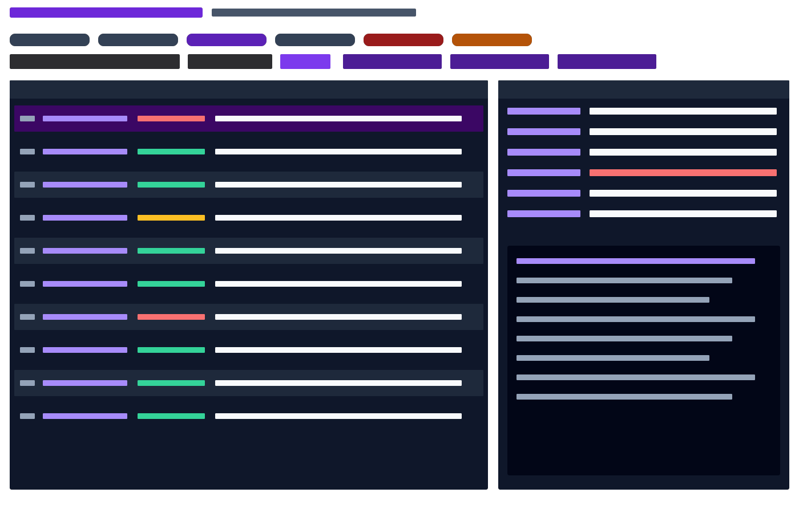

# Envoy Proxy Config Viewer for VS Code

Inspect `envoy.yaml`, `envoy.yml`, `*.envoy.yaml` and `envoy-config.yaml` service-mesh and gateway configs in VS Code without running the Envoy daemon or making network calls. Production Envoy bootstrap files nest listeners, filter chains, HTTP route virtual hosts, upstream clusters, load-assignment endpoints and admin sockets hundreds of lines deep where `admin` bound to `0.0.0.0`, missing TLS `transport_socket`, `trust_all` cert validation, missing circuit breakers or plaintext auth tokens are easy to overlook. This extension parses Envoy YAML locally in plain JavaScript with zero shell or cloud calls.

## What it opens

- `envoy.yaml`, `envoy.yml`, `*.envoy.yaml` and `envoy-config.yaml` files.
- Any open Envoy YAML config file via the Command Palette or Explorer context menu (Open in Envoy Proxy Config Viewer).
- Nothing to install, no Envoy binary required, no network or cloud calls.

## The free part

- Listener and filter-chain explorer: surfaces every listener socket address, port, filter chain count and downstream TLS posture.
- HTTP route virtual-host table: maps virtual hosts, domains, match prefixes, target clusters and route timeouts in one searchable grid.
- Cluster and endpoint inspector: lists cluster discovery types, `connect_timeout`, load-assignment endpoints, upstream TLS contexts and circuit-breaker flags.
- Static security and resilience findings: flags `admin` bound to `0.0.0.0`, missing TLS `transport_socket`, `trust_all` or missing `trusted_ca` cert validation, missing circuit breakers or timeouts, and plaintext auth tokens.

## The Pro tools, with 1 free try

Pro adds the audit, diff and export steps: generate a Markdown Envoy security and resilience audit for one file or a folder, compare two Envoy YAML configs in Markdown for listener, route, cluster and finding deltas, or export a Mermaid listener-to-cluster graph plus Markdown and CSV inventory locally. Your first try of each Pro tool is free. Zovo Pro is USD 19 once, and the team licence is USD 59.

## Why not plain text

Reading a 600-line `envoy.yaml` in plain text buries whether the `admin` interface binds to `0.0.0.0`, whether an upstream cluster forgot `circuit_breakers`, or whether a TLS context omits `trusted_ca`. A local viewer puts listeners, virtual hosts, clusters, endpoints and static findings on one screen.

## More tools by Zovo

See full docs and install options at [vscode.zovo.one/extensions/zovo-envoy-config-viewer/](https://vscode.zovo.one/extensions/zovo-envoy-config-viewer/), browse all Zovo VS Code extensions at [vscode.zovo.one](https://vscode.zovo.one/), or explore [Zovo Pro](https://vscode.zovo.one/pro/).
